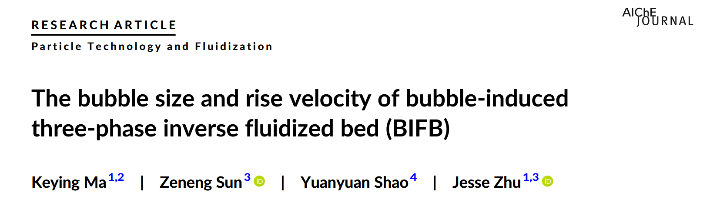
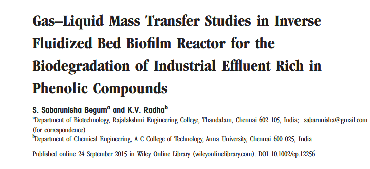
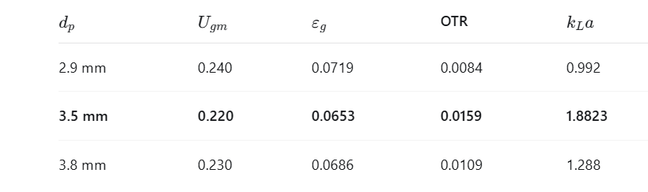
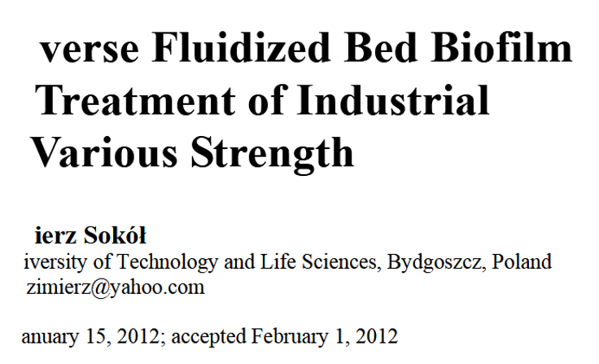
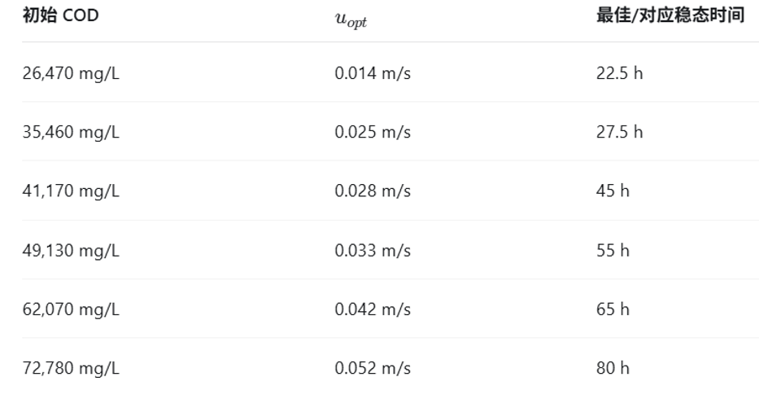
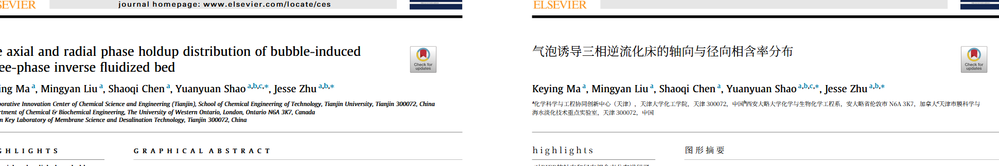

# source

- Source: `source.pptx`
- Total slides: 14

## Slide 1

基于视觉感知与多约束决策的 多相流智能运行优化 Agent

面向多相流的水动力状态识别与曝气优化

▶ 指导老师：罗劭娟丨汇报学生：温盈轩 张定康

### Speaker Notes

1

## Slide 2

1

研究背景

2

已有研究基础

3

Agent总体目标

4

Agent约束条件

5

工作规划

### Speaker Notes

2

## Slide 3

研究背景

（污水处理）BIFB运行过程中纯在多因素耦合调控问题

人工实验

调节Ug

观察床层状态

测COD/DO

调整参数

BIFB运行时存在三个问题：

- 运行参数依赖经验调节：不同装置临界流化气速不同，每次都要实验重新确定本次实验的$𝑈𝑔,𝑖𝑓,𝑈𝑔,𝑐𝑓$
- 曝气参数受到多重约束： 曝气量需要同时满足水动力状态、氧传递能力及污水处理需氧量等要求。
- 运行优化缺乏统一决策机制：需要在在满足多项工艺要求的前提下，实现曝气量的合理配置。

研究需求

构建融合视觉感知、水动力预测与多约束决策的智能运行优化Agent，实现BIFB运行状态的自动识别与曝气参数的辅助优化。

### Speaker Notes

在化工、环保和水处理中：COD = Chemical Oxygen Demand，化学需氧量它主要反映水中有机物、亚铁、硫化物、亚硝酸盐等还原性污染物的多少。COD 越高，说明水中有机/还原性污染物越多，污染越重。常用于评价废水污染负荷、生化处理效果和排放是否达标。

DO = Dissolved Oxygen，溶解氧太低会导致微生物缺氧、处理效果差，太高则浪费曝气能耗。

条件如：COD去除需求 氧传递需求 完全流化需求 能耗

3

## Slide 4

已有研究基础与视觉感知能力

已有气泡算法充当Agent的视觉模块，实现实时输出当前

输出

BIFB实验装置

高速摄影

气泡图像

视觉算法

已具备的核心能力

Agent视觉模块拟提供的输出

- 气泡等效直径 $𝑑𝑏$
- 气泡上升速度 $𝑈𝑏$
- 气泡群统计特征
- 气泡投影面积率

- 气泡目标检测与实例分割
- 气泡运动轨迹追踪
- 基于气泡轮廓的等效直径计算
- 基于连续帧的气泡上升速度测算
- 气泡数量、尺寸分布及运动特征统计

### Speaker Notes

这个数据库的建立，意思是初始版demo的时候可以用老大拍到的照片来作为验证的工具，一开始的功能验证就拿我们拍照的装置做，比如agent算出Ug等于x的时候，给出预测气泡大小和上升速度是y和z这时候和实际的照片测得的气速和大小比较，做验证

4

## Slide 5

已有实验数据与模型基础

依托现有BIFB实验装置及高速摄影系统，已积累不同曝气条件、颗粒浓度及拍摄位置下的实验图像。

已有实验条件

- 实验介质：气–液–固三相体系
- 实验颗粒：聚乙烯颗粒
- 实验变量：曝气量、颗粒浓度、拍摄高度等
- 数据来源：高速摄影图像及对应实验工况记录

已有模型基础

- 气泡尺寸及上升速度测算方法
- BIFB气泡水动力经验关联式
- 氧传递与曝气运行相关文献模型
- 视觉算法及实验数据处理流程

后续数据建设方向

构建统一的BIFB实验数据库，关联实验工况、视觉特征、水动力指标及模型预测结果，为Agent模型拟合与优化决策提供数据支撑。

### Speaker Notes

这个数据库的建立，意思是初始版demo的时候可以用老大拍到的照片来作为验证的工具，一开始的功能验证就拿我们拍照的装置做，比如agent算出Ug等于x的时候，给出预测气泡大小和上升速度是y和z这时候和实际的照片测得的气速和大小比较，做验证

5

## Slide 6

Agent总体目标

### Speaker Notes

在化工、环保和水处理中：COD = Chemical Oxygen Demand，化学需氧量它主要反映水中有机物、亚铁、硫化物、亚硝酸盐等还原性污染物的多少。COD 越高，说明水中有机/还原性污染物越多，污染越重。常用于评价废水污染负荷、生化处理效果和排放是否达标。

DO = Dissolved Oxygen，溶解氧太低会导致微生物缺氧、处理效果差，太高则浪费曝气能耗。

条件如：COD去除需求 氧传递需求 完全流化需求 能耗

6

## Slide 7

Agent总体目标

Agent的总体目标为用户输入当前设置的Ug，处理后输出推荐Ug,并且预测 的大小

Ug的条件约束（如此时化学反应需要的氧气量和流化状态所需的气速的等）

视觉测量得到当前气泡大小，上升速度

判断目前流化床流态等

改变参数后重新识别当前运行情况

给出预测的最优Ug，气泡大小等参数

输入Ug

数据库

公式拟合

### Speaker Notes

在化工、环保和水处理中：COD = Chemical Oxygen Demand，化学需氧量它主要反映水中有机物、亚铁、硫化物、亚硝酸盐等还原性污染物的多少。COD 越高，说明水中有机/还原性污染物越多，污染越重。常用于评价废水污染负荷、生化处理效果和排放是否达标。

DO = Dissolved Oxygen，溶解氧太低会导致微生物缺氧、处理效果差，太高则浪费曝气能耗。

条件如：COD去除需求 氧传递需求 完全流化需求 能耗

7

## Slide 8

Agent预测功能

Agent通过以下步骤实现预测功能

用到的公式和文献来源如下

### Speaker Notes

在条件如：COD去除需求 氧传递需求 完全流化需求 能耗

8

## Slide 9

氧传递效率条件约束

曝气不是越大越好，需要控制OTR的大小

### Speaker Notes

9

## Slide 10

需氧量条件约束

曝气大小还和污水处理中的COD和DO有关

### Speaker Notes

10

## Slide 11

当前遇到问题

从气泡大小来看的话，气泡大小在夹带区域和完全流化阶段的气泡大小是有重合的，不能简单的看气泡大小来判断流化床的水动力阶段。

等等，老大如果从气含率去看呢这篇论文我还没看过

### Speaker Notes

11

## Slide 12

当前遇到问题

我认为初赛看重的是我们的Agent是否拥有智能优化调节的能力，这些公式参数在最初的demo的时候，可以定一个合适的值就行了，不用纠结太多实际生产中参数应该是多少

### Speaker Notes

12

## Slide 13

工作规划

### Speaker Notes

13

## Slide 14

感谢观看

恳请各位老师批评指正

指导老师：罗劭娟 丨 汇报学生：温盈轩 张定康

### Speaker Notes

14
